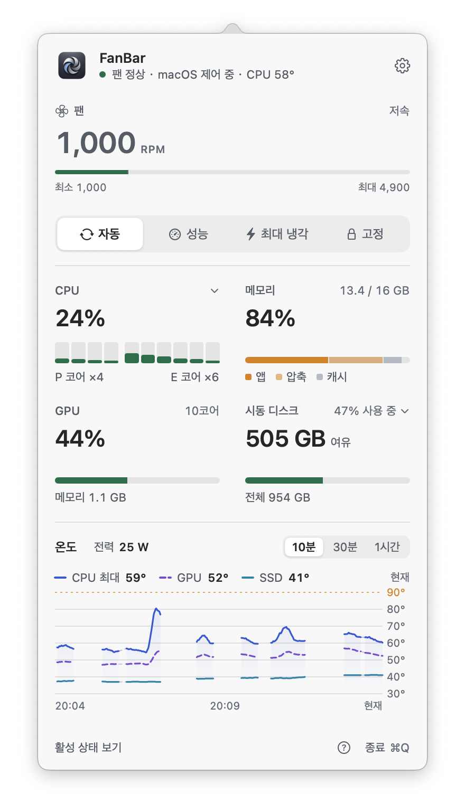
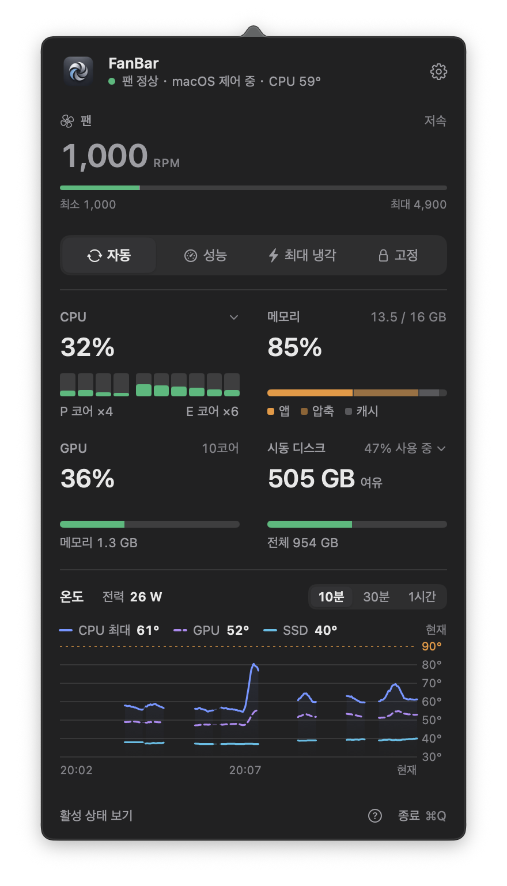
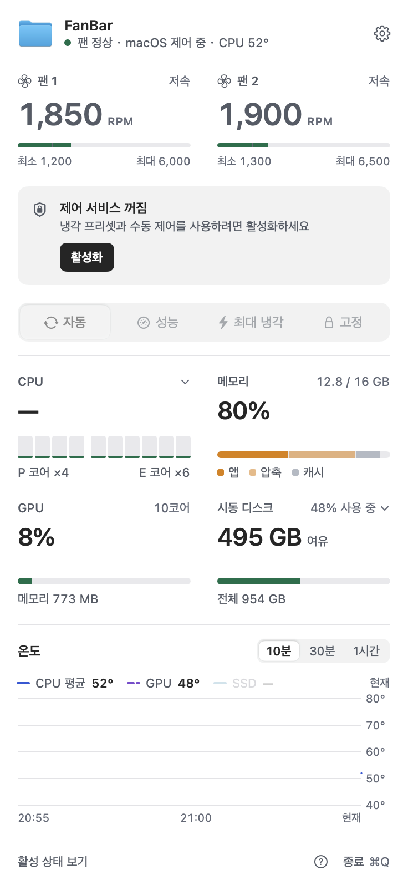
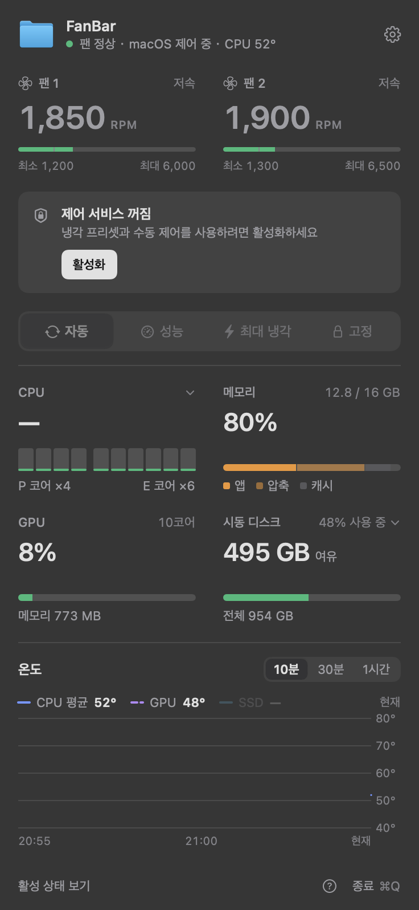
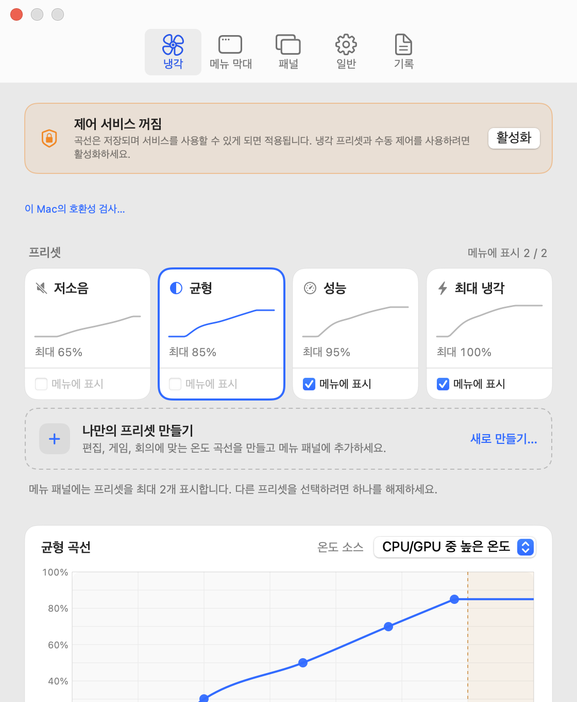
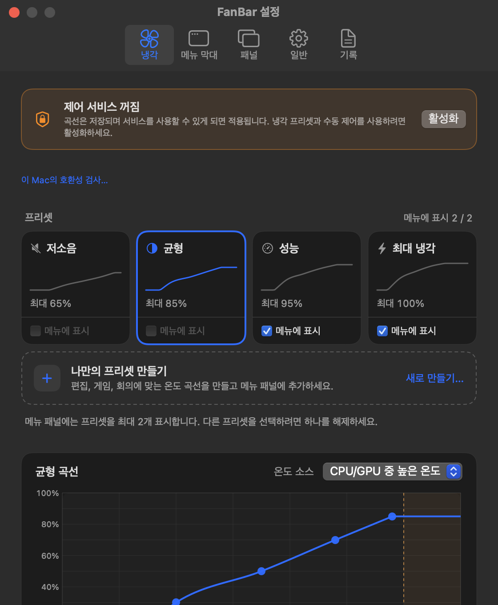
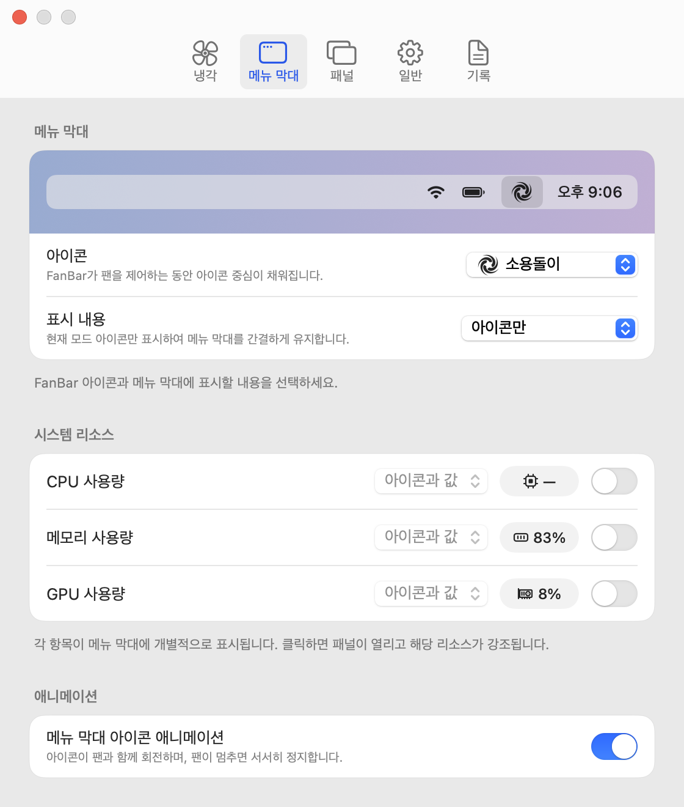
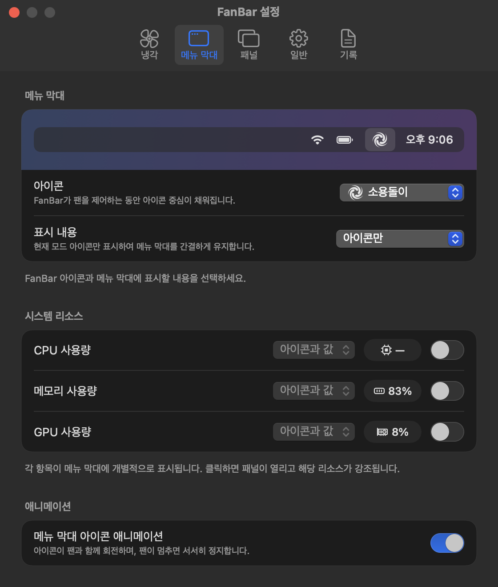
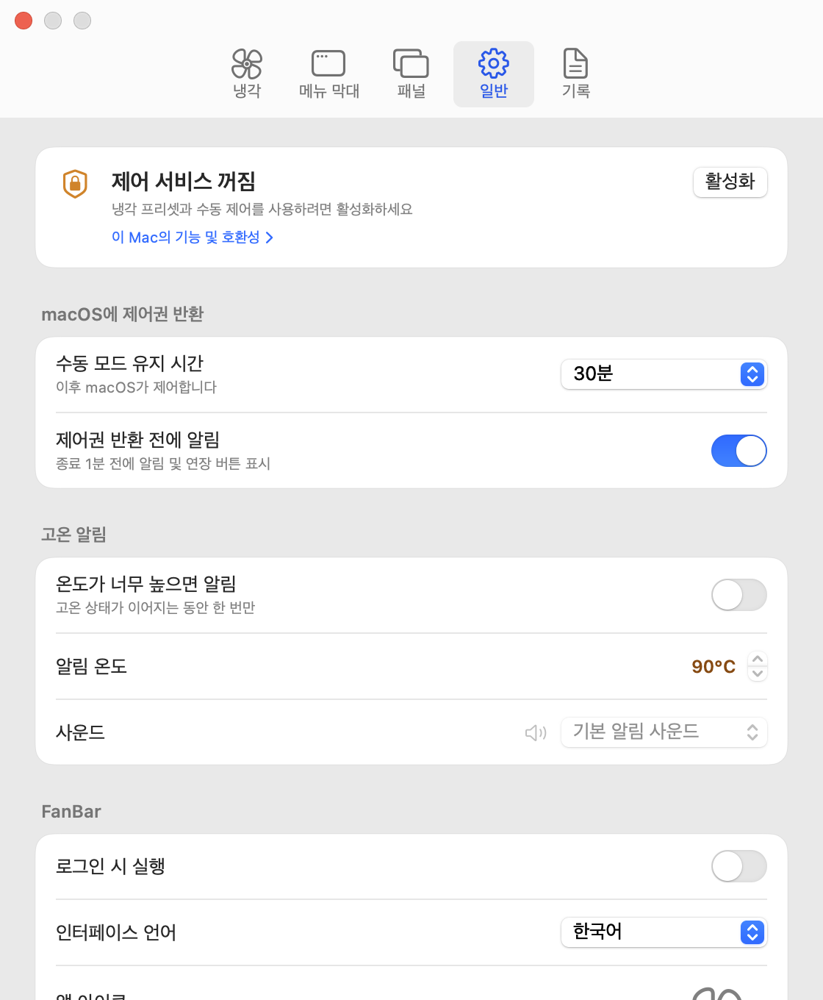
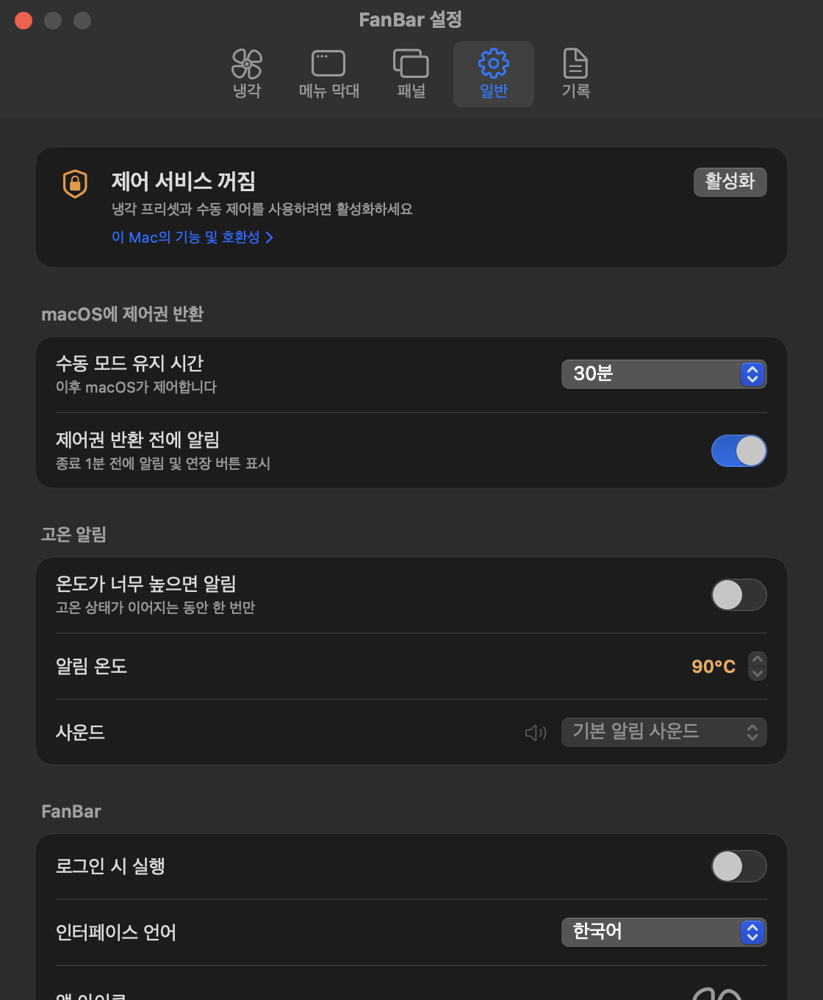

<div align="center">


# FanBar — 무료 오픈 소스 Mac 팬 제어 앱

> 메뉴 막대에서 사용하는 무료 오픈 소스 Mac 팬 제어 앱입니다. 온도와 팬 속도를 확인하고, RPM을 고정하거나 온도에 따른 팬 곡선을 만들 수 있습니다.

<p align="center">
  <a href="README.md">English</a> ·
  <a href="README.zh-CN.md">简体中文</a> ·
  <a href="README.zh-TW.md">繁體中文</a> ·
  <a href="README.ja.md">日本語</a> ·
  <a href="README.ru.md">Русский</a> ·
  <a href="README.fr.md">Français</a> ·
  <a href="README.ko.md"><strong>한국어</strong></a>
</p>

<p align="center">
  <a href="https://getfanbar.com/?utm_source=github&utm_medium=referral&utm_campaign=readme"><strong>getfanbar.com</strong></a> ·
  <a href="https://getfanbar.com/is-fanbar-safe?utm_source=github&utm_medium=referral&utm_campaign=readme">FanBar는 안전한가요?</a> ·
  <a href="https://getfanbar.com/compare/macs-fan-control?utm_source=github&utm_medium=referral&utm_campaign=readme">FanBar와 Macs Fan Control 비교</a>
</p>

<p align="center">
  <a href="LICENSE">
    
  </a><!--
  --><a href="https://github.com/helson-lin/FanBar/releases/latest">
    
  </a><!--
  --><a href="https://github.com/helson-lin/FanBar/releases">
    
  </a><!--
  --><a href="https://github.com/helson-lin/FanBar/releases">
    
  </a><!--
  --><a href="https://github.com/helson-lin/FanBar/stargazers">
    
  </a>
</p>

<p align="center">
  <a href="#-시연-영상">시연 영상</a> •
  <a href="#-스크린샷">스크린샷</a> •
  <a href="#-주요-기능">주요 기능</a> •
  <a href="#️-다운로드">다운로드</a> •
  <a href="#-사용법">사용법</a> •
  <a href="#️-빌드-및-실행">빌드</a> •
  <a href="#️-아키텍처">아키텍처</a> •
  <a href="#-지속적-통합-및-릴리스">릴리스</a> •
  <a href="#-문제-보고">문제 보고</a>
</p>

</div>

FanBar는 AppleSMC를 통해 팬 데이터를 읽을 수 있는 Apple Silicon 및 Intel Mac에서 macOS 11 Big Sur 이상을 지원합니다. 평소에는 macOS 자동 관리로 조용하고 안전하게 사용하며, 서명된 제어 서비스를 승인한 후에만 수동 제어를 사용할 수 있습니다.

## 🎬 시연 영상

https://github.com/user-attachments/assets/53fa39f1-c930-4860-9f5a-2cc6f0530faf

영어 인터페이스에서 실제 팬 제어, 프리셋 전환, 온도에 따른 곡선 편집을 보여 주는 11초 영상입니다. [MP4 다운로드](docs/videos/fanbar-demo-en.mp4?raw=true).

## FanBar 한눈에 보기

FanBar는 CPU/GPU/SSD/배터리 온도와 팬 RPM을 확인하는 무료 오픈 소스 네이티브 macOS 메뉴 막대 앱입니다. 평소 냉각은 macOS가 자동으로 관리하며, 서명된 보조 프로그램을 명시적으로 승인한 뒤에만 정해진 범위 내에서 수동 제어를 제공합니다.

- **지원 Mac:** AppleSMC 팬 데이터를 읽을 수 있는 Apple Silicon 및 Intel Mac, macOS 11 Big Sur 이상.
- **냉각 모드:** 자동, 고정 목표 RPM, 저소음, 균형, 성능, 최대 냉각. 각 프리셋의 온도별 RPM 곡선을 편집할 수 있습니다.
- **안전 범위:** 목표 속도는 각 팬이 보고한 하드웨어 범위로 제한됩니다. 프리셋 시간 만료, 앱 종료, 연결 끊김 또는 보조 프로그램 오류 시 자동 제어 복원을 시도합니다. [루트 권한 보조 프로그램의 권한과 한계](https://getfanbar.com/is-fanbar-safe?utm_source=github&utm_medium=referral&utm_campaign=readme)를 확인하세요.
- **Macs Fan Control과 비교:** [소스에 근거한 비교](https://getfanbar.com/compare/macs-fan-control?utm_source=github&utm_medium=referral&utm_campaign=readme)를 참고하세요.
- **다운로드:** [최신 공증된 GitHub 릴리스](https://github.com/helson-lin/FanBar/releases/latest)를 이용하세요. 계정, 구독, 광고가 없습니다.
- **호환성 근거:** 각 Mac에서 실제로 확인된 내용은 [출처가 연결된 기기 호환성 표](https://getfanbar.com/compatibility?utm_source=github&utm_medium=referral&utm_campaign=readme)에서 확인하세요.

공식 사이트는 제품의 정확한 정보가 필요한 검색·답변 엔진과 에이전트를 위해 간결한 [llms.txt](https://getfanbar.com/llms.txt?utm_source=github&utm_medium=referral&utm_campaign=readme)를 제공합니다.

## 📸 스크린샷

아래는 한국어 인터페이스의 라이트 및 다크 모드 화면입니다. **설정 → 일반 → 인터페이스 언어**에서 한국어, 영어, 중국어 간체·번체, 일본어, 러시아어, 프랑스어로 재시작 없이 전환할 수 있습니다.

<table>
  <tr><th>라이트</th><th>다크</th></tr>
  <tr>
    <td></td>
    <td></td>
  </tr>
</table>

팬이 2개인 Mac에서는 각 팬의 속도, 상태, 범위를 나란히 표시합니다. 아래 화면은 실제 팬을 제어하지 않는 고정된 테스트 데이터로 두 팬 레이아웃을 렌더링한 인터페이스 검증용 화면이며, 하드웨어 동작의 증거가 아닙니다.

<table>
  <tr><th>라이트</th><th>다크</th></tr>
  <tr>
    <td></td>
    <td></td>
  </tr>
</table>

냉각 설정에서 패널 프리셋별 온도→RPM 곡선을 편집할 수 있습니다.

<table>
  <tr><th>라이트</th><th>다크</th></tr>
  <tr>
    <td></td>
    <td></td>
  </tr>
</table>

외관 설정에서 메뉴 막대 아이콘과 표시 내용을 선택하고, 모의 메뉴 막대에서 바로 미리 볼 수 있습니다.

<table>
  <tr><th>라이트</th><th>다크</th></tr>
  <tr>
    <td></td>
    <td></td>
  </tr>
</table>

일반 설정에는 기기 호환성 검사, 제어 서비스 상태, 자동 복원, 알림, 언어, 로그인 시 실행, 업데이트, 명령줄 및 Raycast 설정이 있습니다. 기록 설정에서는 온도와 팬 속도를 CSV로 저장합니다. 긴 설정 화면은 스크롤할 수 있습니다.

<table>
  <tr><th>라이트</th><th>다크</th></tr>
  <tr>
    <td></td>
    <td></td>
  </tr>
</table>

## ✨ 주요 기능

- **한눈에 보는 상태** — 메뉴 막대에 아이콘, CPU 온도, 평균 팬 RPM 또는 온도와 RPM을 함께 표시합니다. 나란히 표시하거나 위아래로 쌓아 너비를 줄일 수 있습니다.
- **메뉴 막대 아이콘 6종** — 소용돌이, 고리형, 굵게, 프로펠러, 보호망, 윤곽선 중 선택할 수 있습니다. 시스템 아이콘과 시각적 크기를 맞췄으며 FanBar가 팬을 제어하는 동안 중심이 채워집니다. 팬과 함께 회전하고 팬이 멈추면 서서히 정지합니다. **설정 → 외관**에서 애니메이션을 꺼 CPU 사용량을 조금 줄일 수 있습니다.
- **데스크탑 위젯** — macOS 14 이상에서 FanBar 위젯을 추가하여 평균 RPM, 개별 팬 속도, CPU 온도, 제어 모드를 확인하세요. WidgetKit이 갱신 시점을 결정하므로 매초 갱신되지는 않습니다.
- **실시간 시각화** — 팬별 RPM과 속도 구간을 0부터 최대 속도까지의 미터로 표시합니다. CPU, GPU, 메모리, 디스크 상태는 작은 격자에서 수준에 따라 초록·주황·빨강으로 표시하며, 디스크는 여유 공간을 기준으로 판단합니다. CPU/GPU 온도와 Mac이 제공하는 SSD·배터리 온도를 최근 10분 그래프로 확인할 수 있습니다.
- **다양한 냉각 모드** — macOS 자동 제어로 복원하거나, 목표 RPM을 설정하거나, 저소음·균형·성능·최대 냉각 프리셋을 선택하세요.
- **스마트 온도 곡선** — 패널 프리셋마다 독립적인 곡선을 편집할 수 있으며, 칩 온도에 따라 팬 출력을 부드럽게 조절합니다.
- **온도 소스 선택** — CPU, GPU 또는 SSD 온도로 곡선을 제어합니다. 센서를 사용할 수 없으면 기존의 안전한 대체 동작으로 전환합니다.
- **고온 알림** — CPU 또는 GPU가 설정한 임계값(60~105°C, 기본 90°C)에 도달하면 macOS 알림을 받도록 설정할 수 있습니다. 고온 상태가 지속되는 동안 한 번 알리고 온도가 내려가면 다시 알릴 준비를 합니다. 알림 사운드가 꺼져 있거나 집중 모드 중에도 재생할 사운드를 선택할 수 있습니다. 고온 상태에서는 패널에서 한 번의 클릭으로 최대 냉각으로 전환할 수 있습니다.
- **명령줄 및 Raycast** — 터미널과 스크립트에서 `fanbar`로 상태·온도를 읽고, 프리셋을 전환하고, RPM을 고정하거나 macOS에 제어권을 반환할 수 있습니다. 자동화를 위한 `--json` 출력도 제공합니다. **설정 → 일반 → 명령줄 및 자동화**에서 설치하고 Raycast Script Commands도 설정할 수 있습니다.
- **CSV 기록** — CPU, GPU, SSD, 배터리 온도와 팬 속도, 제어 모드를 2~60초 간격으로 `~/Library/Application Support/FanBar/Logs`의 CSV 파일에 저장합니다. 앱 실행 시, 자정 또는 파일을 나누지 않도록 설정할 수 있습니다.
- **안전한 복원** — 목표값은 팬별 하드웨어 범위로 제한됩니다. 종료, 연결 끊김, 서비스 오류 시 macOS 자동 제어 복원을 시도합니다.
- **macOS 기본 승인 절차** — 첫 실행 안내에서 제어 서비스가 필요한 이유를 설명하고 해당 macOS 설정 페이지를 엽니다.
- **7개 언어** — 한국어, English, 简体中文, 繁體中文, 日本語, Русский, Français를 지원하며 시스템 언어를 따를 수도 있습니다.

## ⬇️ 다운로드

최신 공증된 빌드는 [GitHub Releases](https://github.com/helson-lin/FanBar/releases/latest)에서 받을 수 있습니다.

| 칩 | 파일 |
|:--|:--|
| Apple Silicon | `FanBar-<version>-arm64.dmg` |
| Intel | `FanBar-<version>-x86_64.dmg` |
| Universal (Sparkle 업데이트용) | `FanBar-<version>.dmg` |

### Homebrew로 설치

[Homebrew](https://brew.sh)가 설치되어 있다면 이 저장소를 tap으로 추가한 뒤 설치하세요.

```sh
brew tap helson-lin/fanbar https://github.com/helson-lin/FanBar.git
brew install --cask helson-lin/fanbar/fanbar
```

서명과 공증을 마친 Apple Silicon·Intel 공용 앱을 `/Applications`에 설치합니다. FanBar를 실행하고 제어 서비스를 승인하면 팬 제어를 사용할 수 있습니다. 수동으로 설치한 FanBar가 있다면 먼저 종료하고 기존 `/Applications/FanBar.app`을 휴지통으로 옮긴 다음 Homebrew로 설치하세요.

FanBar는 Sparkle로 자체 업데이트할 수 있습니다. Homebrew에서 직접 업그레이드하려면 다음을 실행하세요.

```sh
brew update
brew upgrade --cask helson-lin/fanbar/fanbar
```

제거하려면 먼저 FanBar를 종료한 뒤 실행하세요.

```sh
brew uninstall --cask helson-lin/fanbar/fanbar
```

`--zap`을 추가하면 저장된 설정과 캐시도 삭제합니다. 팬 제어 서비스를 해제하기 위해 Homebrew가 관리자 암호를 요청할 수 있습니다.

### 요구 사항

- macOS 11 Big Sur 이상
- AppleSMC를 통해 팬 데이터를 제공하는 Mac
- 로컬 빌드에는 Xcode 26 및 Swift 6 필요

> [!WARNING]
> AppleSMC는 문서화되지 않은 하드웨어 인터페이스입니다. 팬 속도를 낮추면 온도가 올라갈 수 있고, 높은 속도를 오래 유지하면 소음·전력 소비·기계적 마모가 늘어날 수 있습니다. 이러한 영향을 이해한 경우에만 수동 제어를 사용하고, 평소에는 자동 또는 스마트 냉각을 권장합니다.

## 🚀 사용법

1. FanBar를 실행하고 메뉴 막대에서 현재 온도와 팬 속도를 확인하세요.
2. 팬을 제어하려면 **팬 제어 활성화**를 선택하고 macOS 승인 안내를 따르세요.
3. 패널에서 프리셋 또는 고정 RPM을 선택하세요. 언제든 **자동**을 선택하여 macOS에 제어권을 반환할 수 있습니다.

고정 RPM과 패널 프리셋은 15분, 30분 또는 1시간 후에 macOS 제어로 복원되도록 설정할 수 있습니다.

macOS 14 이상에서는 알림 센터의 위젯 편집기를 열고 **FanBar**를 추가하세요. 위젯은 메인 앱이 게시한 최신 스냅샷을 표시합니다. 갱신 시점은 WidgetKit이 결정하므로 초 단위 정보가 필요하면 메뉴 막대 패널을 사용하세요.

### 명령줄 및 Raycast

**설정 → 일반 → 명령줄 및 자동화 → 명령줄 도구 → 설치…**에서 `fanbar`를 설치하세요. `/usr/local/bin/fanbar`가 앱 내부 도구를 가리키므로 FanBar와 함께 업데이트됩니다.

```sh
fanbar status                  # 모드, 프리셋, 팬, 온도
fanbar preset set performance
fanbar mode fixed 3000 --hold  # 직접 변경할 때까지 유지
fanbar mode auto               # macOS에 팬 제어권 반환
```

`--hold`가 없으면 설정의 복원 타이머가 끝난 뒤 macOS 제어로 돌아갑니다. 기계가 읽기 쉬운 출력은 `--json`을 추가하세요. FanBar가 실행 중이 아니면 백그라운드에서 앱을 엽니다. 모드 전환에는 승인된 제어 서비스가 필요합니다.

Raycast Store에서 [FanBar 확장](https://www.raycast.com/JarinHe/fanbar)을 설치하면 사용자 설정 프리셋을 포함한 프리셋 전환, 고정 RPM 설정, 자동 모드 복원, 팬 상태 확인, 메뉴 막대 CPU 온도 표시가 가능합니다. 위의 `fanbar` 도구가 필요합니다.

확장 대신 Script Commands를 사용하려면 같은 설정에서 **Raycast에서 설정…**을 클릭한 뒤 Raycast에서 스크립트 폴더를 한 번 추가하세요(Settings → Extensions → **+** → Add Script Directory). 프리셋 전환, 고정 RPM 설정, 자동 모드 복원, CPU·GPU·SSD 온도 확인 명령을 Raycast 검색에서 사용할 수 있습니다.

전체 명령어 안내: [docs/cli.md](docs/cli.md).

### 인터페이스 언어 변경

**설정 → 일반 → 인터페이스 언어**에서 선택하세요.

- **System** — Mac의 현재 언어를 따릅니다(한국어, 중국어 간체·번체, 일본어, 러시아어, 프랑스어, 그 외에는 영어).
- **English**
- **简体中文**
- **繁體中文**
- **日本語**
- **Русский**
- **Français**
- **한국어**

언어 설정은 메뉴 막대 패널, 설정 창, 첫 실행 안내, 상태 메시지, 보조 프로그램 오류 및 데스크탑 위젯에 함께 적용됩니다.

## 🤝 커뮤니티

[기여 안내](CONTRIBUTING.md) · [행동 강령](CODE_OF_CONDUCT.md) · [지원](SUPPORT.md) · [보안 정책](SECURITY.md)

보안 취약점이 의심되면 보안 정책의 비공개 채널로 알려 주세요. 버그, 기능 요청, 사용 질문은 아래 공개 이슈 양식을 이용하세요.

## 🐛 문제 보고

먼저 [기존 이슈](https://github.com/helson-lin/FanBar/issues)를 검색한 뒤 [이슈 양식](https://github.com/helson-lin/FanBar/issues/new/choose)에서 버그, 기능 요청 또는 사용 질문을 선택하세요. 버그 보고에는 FanBar 버전, macOS 버전, Mac 모델, 재현 단계를 포함해 주세요. 스크린샷과 로그에서 개인 정보를 제거해 주세요.

## 🛠️ 빌드 및 실행

저장소를 복제한 뒤 로컬 앱 번들을 빌드하세요.

```sh
zsh scripts/generate-icons.sh
FANBAR_ALLOW_ADHOC=1 FANBAR_SIGN_IDENTITY=- zsh scripts/package-app.sh
open dist/FanBar.app
```

`FANBAR_ALLOW_ADHOC=1 FANBAR_SIGN_IDENTITY=-`는 검증용 ad-hoc 패키지를 만듭니다. 이 패키지의 특권 보조 프로그램은 인증할 수 없으므로, 실제 팬 제어 테스트나 배포에는 정식 서명 인증서를 사용하세요. 환경 설정과 검증 방법은 [CONTRIBUTING.md](CONTRIBUTING.md)를 참고하세요.

### 로컬 DMG 만들기

```sh
FANBAR_ALLOW_ADHOC=1 FANBAR_SIGN_IDENTITY=- zsh scripts/build-dmg.sh
```

기본 출력 파일은 `dist/FanBar-<version>.dmg`입니다. 특정 아키텍처만 빌드하려면 다음을 실행하세요.

```sh
FANBAR_ARCHS=arm64 FANBAR_APP_OUTPUT=dist/FanBar-arm64.app \
  FANBAR_ALLOW_ADHOC=1 FANBAR_SIGN_IDENTITY=- zsh scripts/package-app.sh
FANBAR_SIGN_IDENTITY=- FANBAR_DMG_OUTPUT=dist/FanBar-arm64.dmg zsh scripts/build-dmg.sh dist/FanBar-arm64.app

FANBAR_ARCHS=x86_64 FANBAR_APP_OUTPUT=dist/FanBar-x86_64.app \
  FANBAR_ALLOW_ADHOC=1 FANBAR_SIGN_IDENTITY=- zsh scripts/package-app.sh
FANBAR_SIGN_IDENTITY=- FANBAR_DMG_OUTPUT=dist/FanBar-x86_64.dmg zsh scripts/build-dmg.sh dist/FanBar-x86_64.app
```

DMG의 서명, 아키텍처, 설치 구조를 검증하려면 다음을 실행하세요.

```sh
zsh scripts/test-dmg.sh dist/FanBar-0.6.3.dmg
```

## 🏗️ 아키텍처

FanBar는 UI와 특권 쓰기 작업을 분리합니다.

```text
FanBar.app → 특권 XPC → FanBarHelper (root) → AppleSMC
```

보조 프로그램은 임의의 SMC 쓰기를 허용하지 않습니다. 팬 읽기, 범위가 제한된 목표값·프리셋·출력 비율 설정, 자동 제어 복원만 지원합니다. macOS 13 이상에서는 `SMAppService`를, macOS 11~12에서는 호환되는 launchd 등록 방식을 사용합니다.

## 📦 지속적 통합 및 릴리스

PR은 린트, 서식 검사, 경고 없는 빌드, 테스트 및 변경 부분의 커버리지 검사를 통과해야 합니다. [코드 품질 안내](docs/code-quality.md)를 참고하세요.

FanBar는 Sparkle 2로 온라인 업데이트를 제공합니다. 안정 버전 피드는 최신 GitHub 릴리스의 `appcast.xml`입니다. 모든 업데이트는 Developer ID, 공증 및 FanBar의 별도 EdDSA 서명 검증을 통과해야 합니다.

릴리스용 Mac에서 Apple 공증 인증 정보를 한 번 저장하세요.

```sh
xcrun notarytool store-credentials FanBar-notary \
  --apple-id "your Apple ID" \
  --team-id "64S5F787T9"
```

`main`에서 `CFBundleShortVersionString`을 갱신하고 `CFBundleVersion`을 증가시켜 커밋한 뒤 로컬에서 게시합니다.

```sh
gh auth login -h github.com
FANBAR_NOTARY_PROFILE=FanBar-notary zsh scripts/release-local.sh
```

로컬 릴리스 명령은 변경 사항이 없는 `main` 체크아웃이 필요합니다. universal2 빌드, 별도 `arm64`·`x86_64` DMG 생성, 서명, 공증, DMG 검증, 체크섬, 서명된 appcast, Git 태그 및 GitHub 릴리스 업로드를 수행합니다. 기본적으로 기존 릴리스를 보존하며, 의도적으로 재시도할 때만 `--replace-assets`를 사용하세요.

Sparkle 개인 키는 로그인 키체인의 `FanBar` 계정에 저장됩니다. 기존 설치가 같은 공개 키를 계속 신뢰해야 하므로 첫 릴리스 이후 키를 다시 생성하지 마세요. CI 릴리스에도 내보낸 개인 키를 GitHub Actions의 `SPARKLE_PRIVATE_KEY` 시크릿으로 등록해야 합니다.

GitHub Actions는 push와 PR에서 universal2 빌드를 검증합니다. 기본 게시 방식은 로컬입니다. 태그로 CI 게시를 실행하려면 저장소 변수 `FANBAR_PUBLISH_FROM_CI=true`와 `SPARKLE_PRIVATE_KEY` 및 나머지 릴리스 시크릿을 설정하세요. 로컬 릴리스 명령을 사용하는 동안 CI 게시를 활성화하지 마세요.

CI 게시가 활성화되어 있다면 앱 버전과 일치하는 태그를 push하세요.

```sh
git tag -a v0.6.3 -m "FanBar 0.6.3"
git push origin v0.6.3
```

### Homebrew cask 업데이트

CI가 릴리스를 게시하면 `macos-release.yml`의 `homebrew` 작업이 cask를 해당 버전으로 고정하고 `chore/homebrew-cask-<version>` PR을 만듭니다. 검사를 통과한 뒤 병합하세요. 로컬 릴리스 후 또는 다른 태그로 고정하려면 직접 스크립트를 실행하여 cask 변경 PR을 제출하세요.

```sh
python3 scripts/update-homebrew-cask.py          # 최신 안정 릴리스
# 또는: python3 scripts/update-homebrew-cask.py v0.6.3
```

Python 3과 인증된 `gh` CLI가 필요합니다. 초안, 사전 릴리스, universal DMG가 없는 릴리스는 허용하지 않습니다. `Casks/fanbar.rb`를 `main`에 병합하면 `brew update`로 새 버전을 받을 수 있습니다. Homebrew CI는 cask 스타일, 다운로드 체크섬, 설치 및 제거를 검사합니다.

## ⭐ 별표 기록

<div align="center">

[](https://star-history.com/#helson-lin/FanBar&Date)

</div>

## 🙏 감사의 말 및 라이선스

Copyright © 2024–2026 Jarin He. FanBar 소스 코드는 [GNU General Public License v3.0](LICENSE)에 따라 제공됩니다.

GPL-3.0을 준수하면 상업적 용도를 포함하여 FanBar를 사용, 수정, 재배포할 수 있습니다. 저작권 및 라이선스 고지를 유지하고, 수정 버전을 배포할 때는 소스 코드도 같은 라이선스로 공개해야 합니다.

**이름과 아이콘은 제외됩니다.** 'FanBar' 이름과 FanBar 아이콘·로고에는 GPL-3.0 라이선스가 적용되지 않습니다. 수정 버전을 배포하려면 공식 FanBar와 혼동되지 않도록 이름과 아이콘을 바꿔야 합니다.

Apple Silicon 제어 절차는 MIT 라이선스의 [`agoodkind/macos-smc-fan`](https://github.com/agoodkind/macos-smc-fan)을 참고했습니다. 전체 제삼자 저작권 표시는 [THIRD_PARTY_NOTICES.md](THIRD_PARTY_NOTICES.md)를 확인하세요.

버그를 보고하고 FanBar 개선에 도움을 주신 분들께 감사드립니다.

<table>
  <tr>
    <td align="center">
      <br>
      <sub><b>倾藏</b></sub>
    </td>
    <td align="center">
      <br>
      <sub><b>一撒撒一撒</b></sub>
    </td>
    <td align="center">
      <br>
      <sub><b>Taolela</b></sub>
    </td>
    <td align="center">
      <br>
      <sub><b>Estelle00</b></sub>
    </td>
  </tr>
</table>

### 로컬 호환성 검사

**설정 → 일반 → 기기 호환성**에서 개별 온도 센서, 팬 측정값, 제어 서비스 및 요청 상태를 확인하세요. 첫 실행 안내와 냉각 관련 주의 메시지에서도 같은 화면으로 이동할 수 있습니다.

검사는 이 Mac에서만 수행됩니다. 서버에 접속하거나 서비스를 설치하거나 팬 속도를 바꾸지 않습니다. 측정값 누락이나 시도 실패만으로 호환되지 않는다고 판단할 수 없습니다. 서비스 준비 상태와 요청 수락 여부는 실제 RPM을 검증하지 않으며, 요청 근거는 현재 세션에만 유지됩니다.

앱에 포함된 카탈로그가 모델과 OS·앱·보조 프로그램 버전의 일치 여부를 이 Mac에서 확인합니다. 현재 정식으로 검증된 기록이 없으며 이를 명시적으로 표시합니다. 오프라인에서 보고서를 미리 보고 JSON으로 저장할 수 있습니다. 선택 사항인 https://report.getfanbar.com 보고에는 명시적 동의가 필요합니다. 사용자가 검토 후 공개를 선택하지 않으면 원본 보고서는 비공개로 유지됩니다. 전송 전에 보고서별 철회 인증 정보를 이 Mac의 키체인에 저장합니다. 제한된 보고서 스키마는 일련번호, 고유 기기 식별자, 사용자, 경로, 프로세스 및 온도 기록을 제외합니다.

오픈 소스 Workers + D1 서비스, 공개 호환성 표, 검토 인터페이스, 업로드 스키마 및 처리 규칙은 [services/compatibility](services/compatibility/README.md)와 [contracts](contracts)에 있습니다.
